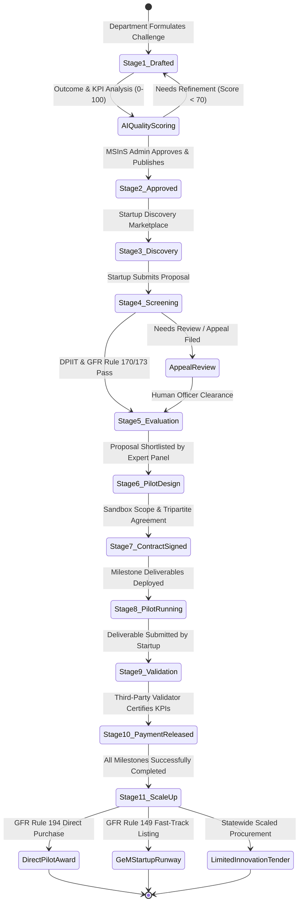

# NavSetu Domain Context & Architecture

> **NavSetu (नवसेतु)** is the Startup-Friendly Innovation Procurement Platform for the Government of Maharashtra and the Maharashtra State Innovation Society (MSInS), built for Smart India Hackathon 2026 (Problem Statement ID 26136).

---

## 1. Domain Glossary (Ubiquitous Language)

| Term | Definition | Avoid Calling It |
| :--- | :--- | :--- |
| **Challenge** | An outcome-based problem statement formulated by a Maharashtra government department specifying desired outcomes, measurable KPIs, budget ceiling, sandbox duration, data sensitivity, and IP preference. Identified by `NS-YYYY-NNNNNN`. | "ticket", "complaint", "bug", "task" |
| **Department User** | An administrative or technical official from a Maharashtra government department (e.g., Public Health, Agriculture, Urban Development) authorized to post challenges, review pilot proposals, and sign off on milestone vouchers. | "client", "reporter", "citizen" |
| **Startup** | A DPIIT-recognized startup or innovative venture proposing novel technologies, running controlled sandboxed pilots, and delivering verified field outcomes under GFR relaxation rules. | "vendor", "agency", "freelancer" |
| **MSInS Admin** | A nodal officer from the Maharashtra State Innovation Society authorized to approve challenges, assign expert evaluators, oversee sandbox agreements, and authorize scale-up procurement pathways. | "superadmin", "moderator" |
| **Expert Evaluator** | An independent technical, commercial, or domain expert (e.g., IIT Bombay, VJTI, sectoral research chairs) who scores startup proposals across weighted evaluation criteria and declares conflicts of interest. | "judge", "reviewer", "grader" |
| **Independent Validator** | A certified third-party technical audit organization (e.g., VJTI Quality Audit Bureau, certified testing laboratories) that conducts field audits and issues binding KPI achievement certificates. | "inspector", "checker" |
| **Pilot Sandbox** | A controlled, time-bound, ring-fenced testing environment where an eligible startup deploys and tests its solution under real-world departmental conditions with explicit data/IP safe-harbor protections. | "test environment", "demo" |
| **Milestone Voucher** | A contractual deliverable tied to a specific financial tranche; releases payment upon independent validation with an automated SLA turnaround timer ("days since approval"). | "bill", "invoice", "receipt" |
| **Scale-Up Decision** | A statutory determination (Scale / Extend / Stop) transitioning a successful pilot into statewide procurement via Direct Award (GFR Rule 194), Limited Tender, or GeM Startup Runway (GFR Rule 149). | "close", "promote", "done" |
| **Public Tracking ID** | An authoritative formatted identifier: `NS-YYYY-NNNNNN` (e.g., `NS-2026-001042`), normalized across all search, tracking, and GeM export interfaces. | "UUID", "ID", "slug" |

---

## 2. 11-Stage Statutory Procurement Lifecycle

---

## 3. The 4 AI Triage & Advisory Services

1. **Challenge Quality Score (0–100)**:
   - Evaluates problem statements to ensure they are **outcome-oriented rather than solution-prescriptive**.
   - Checks for measurable, quantified KPIs, realistic budget and pilot durations, and explicit data sensitivity and IP preferences.
   - Provides instant actionable flags and suggestions to department users before administrative submission.

2. **Startup Eligibility Engine**:
   - Automated rule engine applying **GFR Rule 170 / 173 exemptions** (turnover and prior experience waivers for DPIIT-recognized startups).
   - Validates DPIIT registration format, incorporation age (< 10 years), and sector relevance.
   - Enforces a **mandatory procedural appeal pathway** for flagged applications—failures are never silently final.

3. **Startup–Challenge Match Score (0–100)**:
   - Calculates multidimensional alignment based on sector classification, core technical keywords, Technology Readiness Level (TRL 5–9), past pilot experience, and Maharashtra district location.

4. **Proposal Evaluation Matrix**:
   - Weighted scoring system across Innovation (20%), Technical Feasibility (20%), Team Capability (20%), Cost & Commercial Viability (15%), Data Security & Cyber-Safety (10%), and Scalability (15%).
   - Flags potential conflicts of interest among evaluators and aggregates scores for MSInS committee decisions.

---

## 4. Standard Procurement Template Suite

NavSetu includes 7 standardized, pre-approved procurement templates compliant with Maharashtra public procurement guidelines:
1. **Outcome-Based Problem Statement Template**
2. **Weighted Evaluation & Scoring Matrix**
3. **Tripartite Sandbox Pilot Agreement**
4. **Data Protection & IP Allocation Clauses**
5. **Cybersecurity & CERT-In Compliance Checklist**
6. **Innovation Pilot Risk Register**
7. **Statutory Scale-Up & GeM Procurement Pathway Guide**

---

## 5. Security & Authentication Architecture

- **Authentication**: Real Firebase Authentication (Email/Password, Google OAuth, Email Verification, Password Reset). Zero mock credentials or hardcoded users.
- **Session Security**: Firebase ID tokens exchanged on the backend for 5-day `httpOnly`, `Secure`, `SameSite=Lax` session cookies (`createSessionCookie` with `checkRevoked: true`).
- **Token Persistence**: Client SDK configured with `inMemoryPersistence`; auth tokens are never written to `localStorage` or `sessionStorage`.
- **Role Enforcement**: User roles (`DEPARTMENT_USER`, `STARTUP`, `INNOVATION_SOCIETY_ADMIN`, `EVALUATOR`, `VALIDATOR`) enforced via server-issued Firebase Custom Claims.
- **Multi-Factor Authentication (MFA)**: TOTP enrollment mandatory for `INNOVATION_SOCIETY_ADMIN` and available for all users.
- **BOLA / IDOR Guarding**: Strict object-level ownership checks across challenge drafting, proposal scoring, milestone deliverable submission, and payment authorization.
- **Injection & Network Hardening**: Strict Helmet Content-Security-Policy (CSP), custom double-submit CSRF cookies, SSRF private IP blocker, and binary magic-byte inspection on file uploads.
